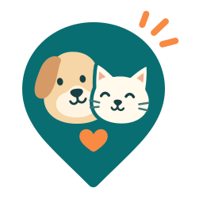
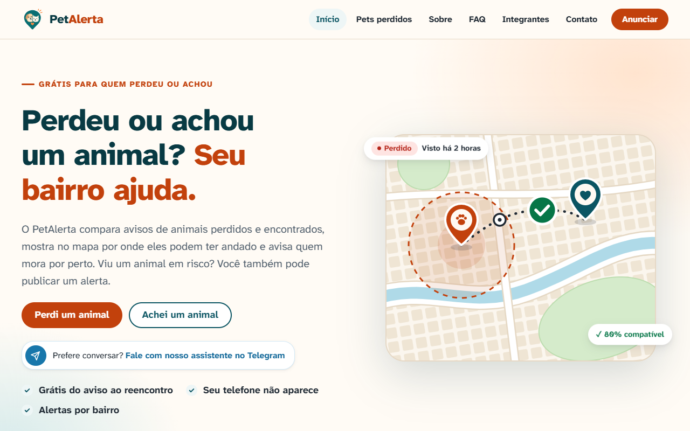
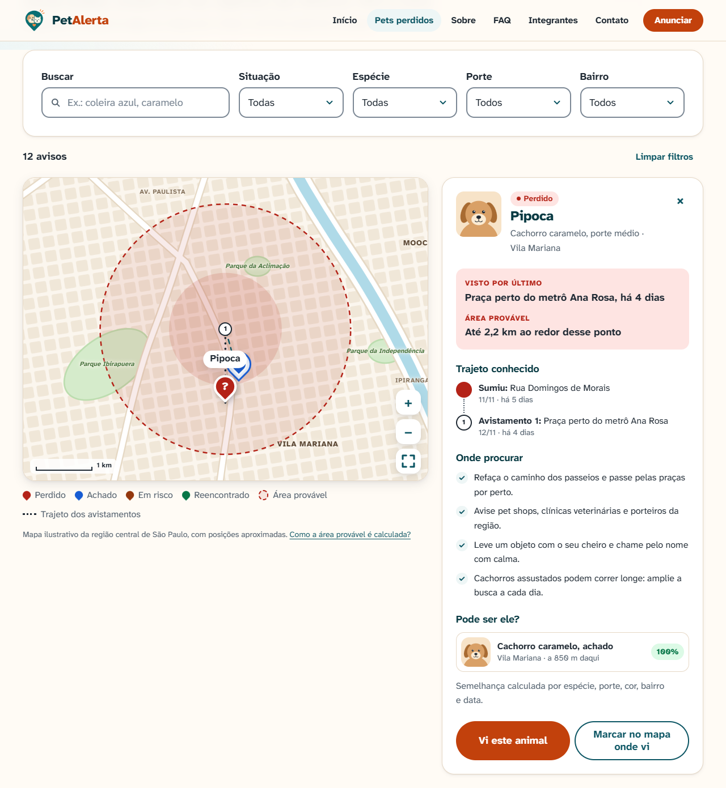
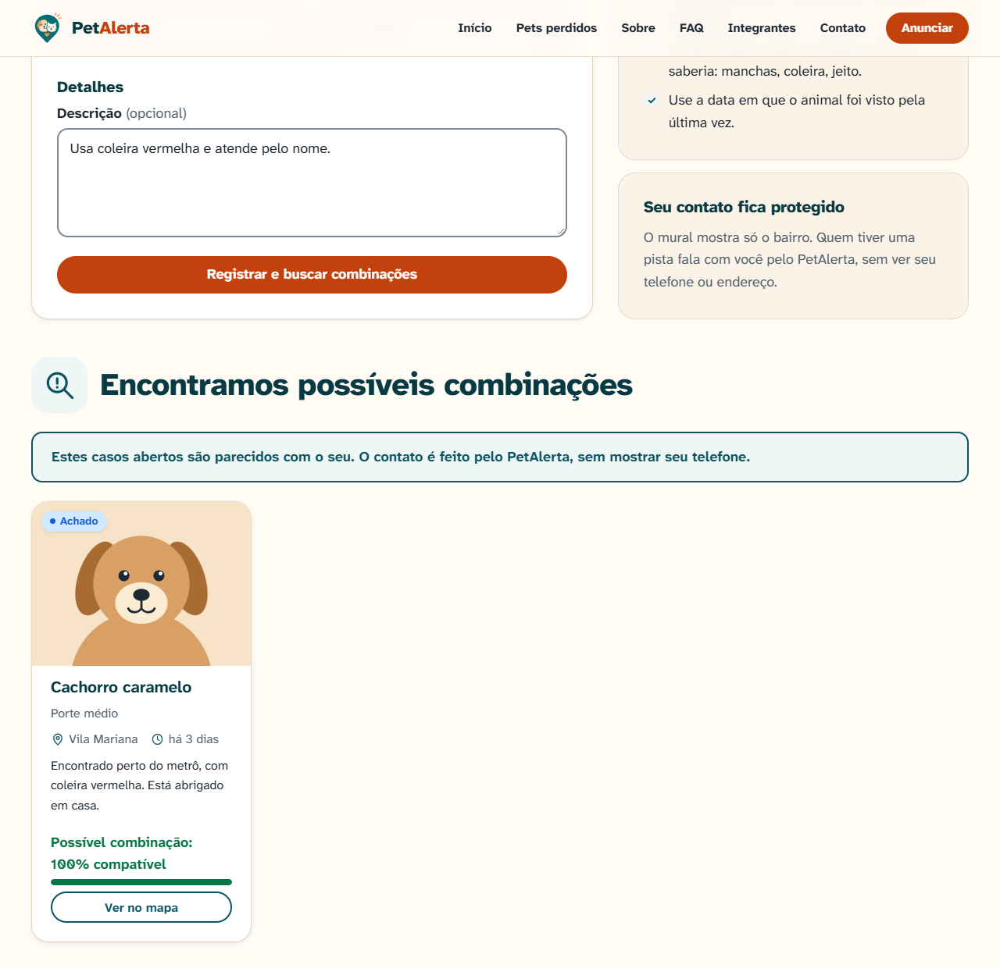
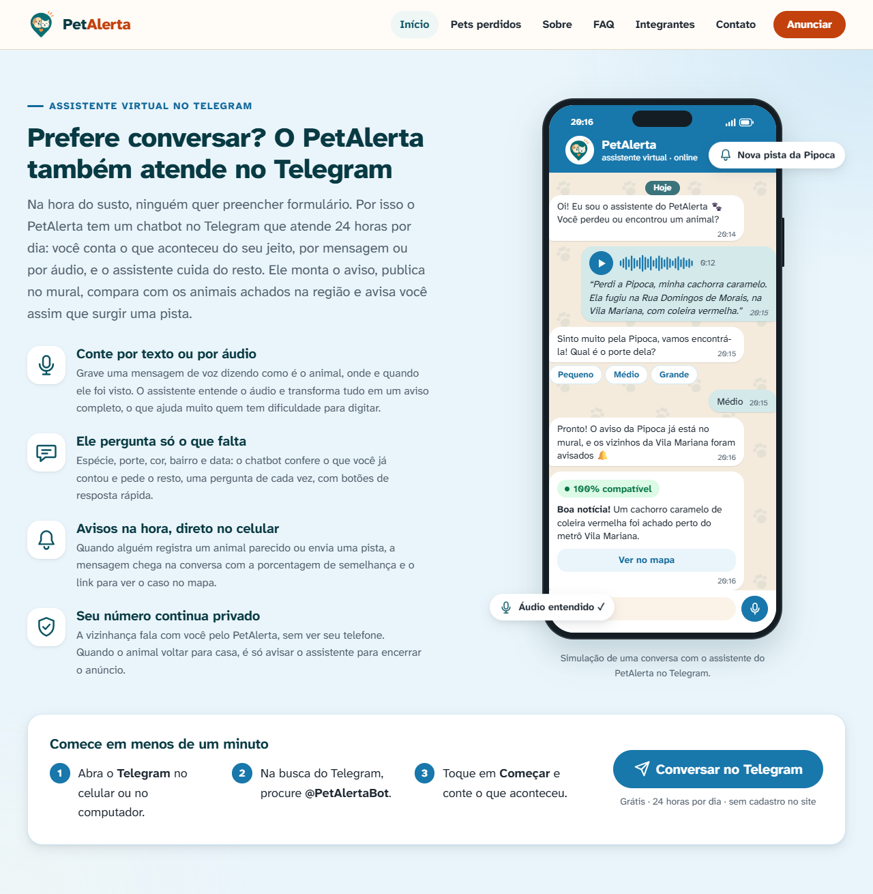
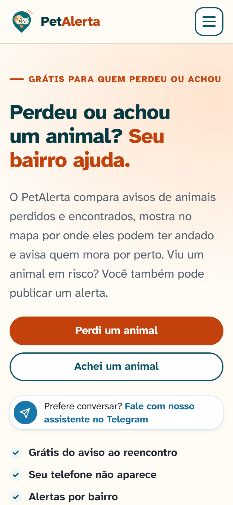
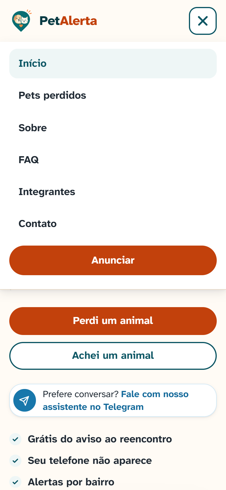
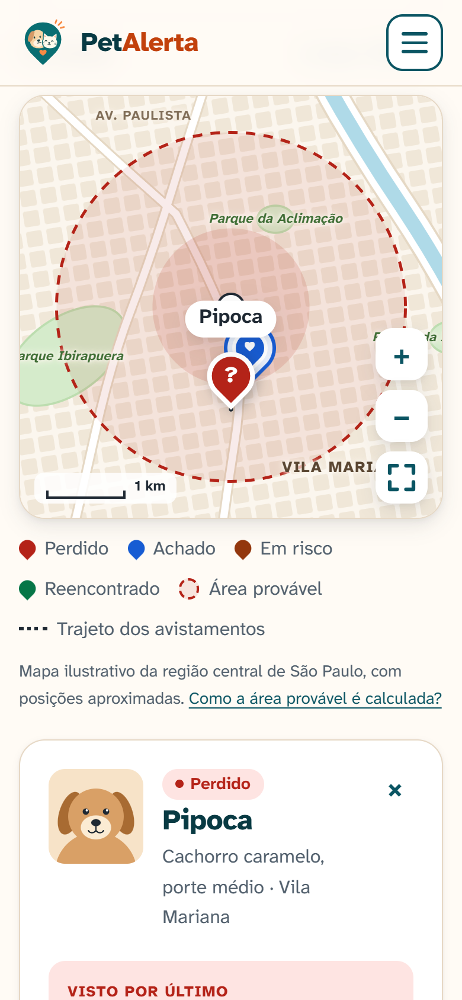
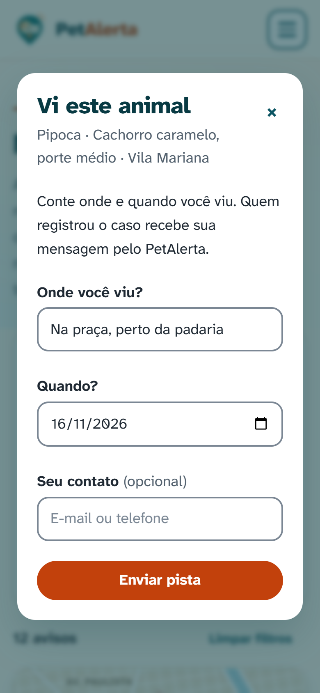

<p align="center">
  
</p>

<h1 align="center">PetAlerta</h1>

<p align="center">
  Tecnologia para a vizinhança cuidar dos seus animais.<br>
</p>

<p align="center">
  
  
  
</p>

## Descrição
Quando um animal some, o aviso se perde em grupos de WhatsApp, e quem encontra
um animal na rua não sabe a quem avisar. O **PetAlerta** reúne casos de animais
perdidos, achados e em risco por bairro, sugere possíveis combinações entre
"perdido" e "achado", mostra no mapa por onde o animal pode ter andado e avisa
a vizinhança. Também atende por um **assistente virtual no Telegram**, que aceita
texto e áudio. O tutor nunca paga.

Projeto da Global Solution 2026/2 da FIAP, tema **CitizenTech** (ODS 3 e 11).
Este repositório contém o front-end: um protótipo navegável com dados fictícios.

## Tecnologias utilizadas

**Linguagens**
- **HTML5:** estrutura semântica das 7 páginas
- **CSS3:** visual e layout responsivo, com variáveis, Flexbox, Grid e Media Queries
- **JavaScript:** toda a interatividade, sem frameworks nem bibliotecas (o mapa também é feito
  à mão, em SVG)

**Ferramentas e outros recursos**
- Git e GitHub
- Fonte Atkinson Hyperlegible Next (Google Fonts), criada para leitores com baixa visão

## Estrutura de pastas
```text
petalerta/
├── index.html          Página inicial (assistente no Telegram e seção para quem encontrou um animal)
├── pets.html           Solução 1: pets com filtros, mapa da busca e envio de pistas
├── anunciar.html       Solução 2: anúncio e cruzamento de casos
├── sobre.html          Problema, solução e impacto (abas)
├── faq.html            Perguntas frequentes (acordeão)
├── integrantes.html    Equipe
├── contato.html        Formulário com validação
├── README.md
├── integrantes.txt     Identificação do grupo
├── css/
│   ├── base.css        Variáveis, reset, tipografia e layout
│   ├── componentes.css Peças reaproveitadas: cabeçalho, botões, cartões, selos, formulários, modal...
│   ├── paginas.css     Seções de cada página
│   └── mapa.css        Mapa da busca e painel "Por onde procurar" (só na página de Pets)
├── js/
│   ├── menu.js         Menu hambúrguer (todas as páginas)
│   ├── dados.js        Casos fictícios, datas e textos de apoio
│   ├── cruzamento.js   Regra de compatibilidade entre perdidos e achados
│   ├── cards.js        Cards dos casos e ilustrações pintadas na cor de cada animal
│   ├── validacao.js    Validação reaproveitada pelos formulários
│   ├── mapa.js         Componente do mapa: desenho, pinos, área provável, zoom e marcação
│   ├── pets.js         Filtros, cards, mapa, painel e modal de pistas
│   ├── anunciar.js     Formulário que se adapta e resultado do cruzamento
│   ├── inicio.js       Animais procurados e animação da conversa do Telegram
│   ├── sobre.js        Abas
│   ├── faq.js          Acordeão
│   └── contato.js      Envio simulado do contato
└── assets/
    ├── images/         Ilustração da página inicial e avatar
    │   └── prints/     Prints do site usados neste README
    └── icons/          Ícones SVG
```

## Organização do CSS
- **Ordem em camadas:** `base.css` → `componentes.css` → `paginas.css` (+ `mapa.css` na página de Pets).
- **Variáveis semânticas:** os componentes usam papéis (`--cor-acao`, `--cor-superficie`,
  `--cor-texto-suave`, `--cor-texto-invertido`) e não cores soltas. Cada cor tem a mesma
  escala: `-suave` → `-clara` → `-media` → cor → `-forte`. A seção escura e o rodapé só
  trocam esses papéis (inclusive `--cor-acento` e `--cor-foco`) e todo o conteúdo se adapta.
- **Espaços responsivos por variável:** `--espaco-secao` e `--espaco-cartao` mudam nas
  media queries do `:root`, e as seções e cartões não precisam repetir regras.
- **Situação sem repetição:** o atributo `data-situacao="perdido"` (ou achado, risco,
  reencontrado) vira as variáveis `--tom` e `--tom-fundo`, usadas por selos, cards, pinos
  e áreas do mapa. Cada cor é definida uma vez só.
- **Variações por variáveis:** `.botao--secundario`, `.botao--fantasma` etc. só trocam
  variáveis; o visual do botão é escrito uma vez.
- **Estado no HTML:** o CSS lê `aria-expanded`, `aria-selected`, `aria-pressed` e
  `aria-invalid`, então o JavaScript só muda atributos, e o mesmo atributo serve ao
  leitor de tela e ao visual.

## Funcionalidades em JavaScript
- Menu mobile: abre e fecha pelo `aria-expanded`; fecha com Esc, clique fora ou ao escolher um link
- Pets: filtros por situação, espécie, porte e bairro e busca por texto (ignora acentos)
- Mapa da busca: latitude e longitude viram posições no desenho (regra de três); pinos com
  símbolo por situação; zoom animado, arrastar com o mouse e régua de escala
- Área provável: parte do último lugar onde o animal foi visto e cresce a cada dia sem notícias
  (gato 300 m + 100 m/dia até 1,5 km; cachorro 600 m + 400 m/dia até 4 km; ave 800 m + 600 m/dia
  até 5 km). Para um animal achado, mostra a área onde a família provavelmente mora: o centro é o
  ponto mais antigo em que ele foi visto (local do aviso ou avistamento com data anterior) e não
  se move quando chegam avistamentos mais recentes
- Marcar no mapa onde viu o animal: a pista vira um avistamento, entra no trajeto e a área é recalculada
- Painel "Por onde procurar": resumo, trajeto, dicas por espécie e possíveis combinações com distância
- Anunciar: formulário muda conforme "Perdi" ou "Achei" (atributo `data-mostrar-se`) e cruzamento
  de casos (mesmo bairro 40, mesmo porte 20, mesma cor 20, datas até 7 dias 20; mínimo 60)
- Validação genérica: as regras ficam no HTML (`required` + `data-erro`); mostra todos os erros e
  leva o foco ao primeiro
- Abas (com setas, Home e End) e acordeão (abre direto por link, como `faq.html#pergunta-mapa`)
- Assistente no Telegram: a conversa de exemplo da página inicial aparece mensagem por mensagem
  quando a seção entra na tela (com `IntersectionObserver`); sem JavaScript ou com "reduzir
  movimento" ligado, ela já aparece inteira
- Links diretos: `pets.html?caso=2`, `pets.html?situacao=perdido`, `anunciar.html?tipo=achado`,
  `index.html#telegram`

## Imagens do projeto

### Versão para computador

**Página inicial**



**Mural: filtros, mapa da busca e painel "Por onde procurar"**



| Anunciar e cruzamento de casos | Assistente no Telegram |
|:---:|:---:|
|  |  |

### Versão para celular

| Página inicial | Menu aberto | Mural com o mapa | Enviar uma pista |
|:---:|:---:|:---:|:---:|
|  |  |  |  |

## Autores
| Nome completo | RM | Turma | GitHub | LinkedIn |
|---|---|---|---|---|
| Gustavo Policarpo | RM 574269 | [1TDSPT] | [policarpogustavo](https://github.com/policarpogustavo) | [gupolicarpo](https://www.linkedin.com/in/gupolicarpo/) |
| Bruno Vieira de Godois | [RM 575296] | [1TDSPT] | [brunovgodois](https://github.com/brunovgodois) | [brunovgodois](https://www.linkedin.com/in/brunovgodois/) |
| Samuel da Silva Ribeiro | RM 576499 | [1TDSPT] |[SamuelRibeirodev] (https://github.com/SamuelRibeirodev) | [samuudev] (https://www.linkedin.com/in/samuu-dev/) |
| Guilherme Henrique | RM 575071 | [turma] | [link] | [link] |
| [Nome] | [RM] | [turma] | [link] | [link] |

## Repositório
[github.com/policarpogustavo/petalerta](https://github.com/policarpogustavo/petalerta)

## Contato
Gustavo Policarpo: [gustavopolicarpo2001@gmail.com](mailto:gustavopolicarpo2001@gmail.com)

### Uso de IA generativa
O Claude (Anthropic) foi usado apenas como apoio em três momentos do projeto:
ajudar a equipe a encontrar o tema, levantar ideias para o site e corrigir bugs
na revisão final. Todo o código HTML, CSS e JavaScript foi desenvolvido pela equipe.

## Créditos
- Ilustrações e ícones SVG: criados para o projeto